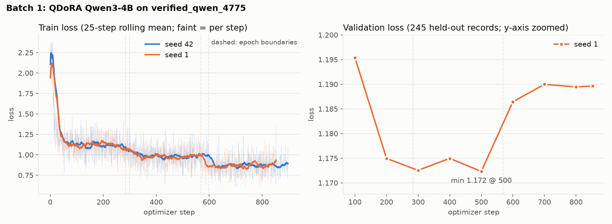

# Training progress

Log of every student batch: data, config, jobs, results. Numbers as reported by the jobs, not rounded
guesses. Student `Qwen/Qwen3-4B-Instruct-2507`, QDoRA (`method: dora`, 4-bit), 1 x A100 per seed
(Booster, `boost_usr_prod`). Paths are relative to `$REPO` = `/leonardo_work/EUHPC_D30_031/alembic/alembic`.

| Result | File | Written by |
|---|---|---|
| Train / val loss per step | `seed_<n>/adapters/step_<N>/adapter/trainer_state.json`, MLflow | `slurm/train.sbatch` |
| Final adapter, config eval set | `seed_<n>/eval_summary.json` | `slurm/evaluate.sbatch` |
| Every kept step, dataset_v1 dev slice | `seed_<n>/adapters/step_<N>/eval_summary.json`, MLflow `dev/...` | `slurm/evaluate_checkpoints.sbatch` |

MLflow: `$REPO/mlruns`, experiment `distillkit`, one run per seed named after its run dir (`uvx mlflow ui`).
Adapters: `<run>/seed_<n>/adapter/` (final, + tokenizer), `<run>/seed_<n>/adapters/step_<N>/adapter/` (per step).

## Summary: final adapters, config eval set

`data/eval/eval_all_v2.jsonl` (66 normal) + `data/eval/eval_tools.jsonl` (16 tool), judge
`openai/gpt-oss-20b`, protocol `paired-orders-v2-invalid-incomplete`. Mean over seeds 42, 1, 2
(B1: 42, 1), seed range in brackets. Correct-call (AST) accuracy is 1.0 for every batch and the base.

| Batch | Change | Win rate vs base | Check pass | Bad-flag rate | Tool decision | False-call | Grounded |
|---|---|---|---|---|---|---|---|
| Base | – | – | 0.955 | 0.025 | 1.0 | 0.167 | 1.0 |
| B1 | 4,775 records, 3 ep, lr 1e-4 | 0.324 [0.307-0.341] | 0.864 | 0.289 | 0.875 | 0.500 | 0.923 |
| B2 | 1 ep, lr 5e-5 | 0.326 [0.292-0.367] | 0.899 | 0.220 | 0.854 | 0.389 | 0.838 |
| B3a | + Slurm prose (119 x3) | **0.359** [0.333-0.379] | 0.904 | 0.098 | 0.875 | 0.333 | 0.833 |
| **B3b** | **+ Slurm prose and tools (182 x3)** | **0.359** [0.356-0.364] | **0.924** | **0.059** | **1.000** | **0.000** | **1.000** |
| B3b-r8 | 3b, rank 8 | 0.355 [0.326-0.375] | 0.919 | 0.082 | 0.979 | 0.167 | 0.970 |
| B5 | HPC10K snapshot 7,743 + 2k retained | cancelled | – | – | – | – | – |
| **B6** | **HPC10K merged 10,773 + 2k retained** | **0.369** [0.326-0.394] | **0.949** | 0.098 | **1.000** | **0.000** | **1.000** |

**Conclusions (B1-B3)**
1. Settings alone (B1 → B2) change nothing: the regression comes from the data, not overtraining.
2. On-topic Slurm prose (B3a) halves invalid flags (0.22 → 0.10) and lifts the win rate to 0.36.
3. Slurm tool traces (B3b) are the best run: flags 0.06; on tool questions it matches or beats the base
   (decision 1.0, 0 false calls vs base 0.167, no invented job ids).
4. Rank 8 is no better than 16 (more flags, false calls back to 0.167): keep rank 16.
5. Earlier checkpoints do not help: dev win rate flat at 0.30-0.35 across steps.
6. Still below the base on normal questions (0.36 vs 0.5) with 182 new records (3% of the mix) → HPC10K
   data (`docs/plan/HPC10K_DATA.md`, branch `feat/data-hpc10k`), batch 5.

**Per-step dev slice** (dataset_v1 development, 106 normal + 23 tool), win rate vs base:

| Run | Step 100 | Step 200 | Final step |
|---|---|---|---|
| B1 seed 42 | – | – | 0.330 (800), 0.349 (897) |
| B2 seed 42 | 0.325 | 0.316 | 0.314 (284) |
| B2 seed 1 | 0.333 | 0.307 | 0.300 (284) |
| B2 seed 2 | 0.302 | 0.300 | pending |

Dev-slice false-call rate 0.222 at every B2 step (base 0.111). B3 per-step dev: pending (jobs 59920008,
59920016, 59920263).

## Batch 1: verified_qwen_4775 (2026-10-10)

- **Data:** `data/teacher/verified_qwen_4775/verified.jsonl` (PR #25), 4,775 records, SHA-256 `3f99eefb…`;
  tokens/example median 164, max 1,520, 0 over `max_length`.
- **Config** `configs/qwen3_4b_qdora.yaml`: r/alpha/dropout 16/32/0.0; lr 1e-4 cosine; 3 epochs; batch 4 x
  grad accum 4 (eff. 16); max_length 2048; bf16; save_steps 100 (newest 2 kept); val_fraction 0.05
  (seeds 1, 2 only). ~3.1 s/step.

| Seed | Run dir | Code | Val split | MLflow | Train job | Steps | Wall | Eval job |
|---|---|---|---|---|---|---|---|---|
| 42 | `runs/verified4775_qdora` | 5873df7 (PR #27) | none | no | 59911612 | 897 | 51.5 min | 59917194 |
| 1 | `runs/verified4775_qdora_v2` | a15dc23 (PR #28) | 4,530 / 245 | yes | 59912914 | 852 | 47.8 min | 59914593 |
| 2 | `runs/verified4775_qdora_v2` | 3738b9b (PR #29) | 4,530 / 245 | yes | 59915034 | 852 | 48.6 min | 59915059 (cancelled) |

Seed 42 (older code) has only steps 800, 897 as per-step adapters (copied by hand from
`checkpoints/checkpoint-{800,897}`); seed 1 has steps 100-852. The final adapter = the last step's weights.

**Loss** (): step-1 loss 2.11 / 1.94, avg 1.009 / 1.009, token acc
0.63 → ~0.72 / 0.66 → ~0.71 (seed 42 / 1). Train loss drops at each epoch boundary; seed 1 val loss:

| Step | 100 | 200 | 300 | 400 | 500 | 600 | 700 | 800 | 852 |
|---|---|---|---|---|---|---|---|---|---|
| Val loss | 1.195 | 1.175 | 1.173 | 1.175 | **1.172** | 1.186 | 1.190 | 1.189 | 1.190 |
| Val token acc | 0.704 | 0.706 | 0.707 | 0.708 | 0.707 | 0.707 | 0.706 | 0.707 | 0.707 |

Lowest at steps 300-500; epoch 3 likely overfits.

**Per seed, config eval set (132/132 verdicts valid):**

| Metric | Base | Seed 42 | Seed 1 |
|---|---|---|---|
| Win rate | – | 0.341 | 0.307 |
| Check pass / bad-flag rate | 0.955 / 0.025 | 0.864 / 0.255 | 0.864 / 0.324 |
| Answers with bad flags | 2 | 9 | 8 |
| Tool decision / false-call / grounded | 1.0 / 0.167 / 1.0 | 0.875 / 0.5 / 0.923 | 0.875 / 0.5 / 0.923 |
| Tool valid / AST / exec ok | 1.0 / 1.0 / 1.0 | 1.0 / 1.0 / 1.0 | 1.0 / 1.0 / 1.0 |

**Seed 42 dev slice** (job 59914860, 212/212 valid; `track` fails without MLflow, results complete):

| Metric | Base | Step 800 | Step 897 |
|---|---|---|---|
| Win rate | – | 0.330 | 0.349 |
| Check pass / bad-flag rate | 0.943 / 0.029 | 0.915 / 0.211 | 0.915 / 0.250 |
| Answers with bad flags | 3 | 9 | 9 |
| Tool decision / false-call / first-response pass | 0.957 / 0.111 / 0.957 | 0.913 / 0.222 / 0.870 | 0.913 / 0.222 / 0.870 |
| Tool raw call rate | 0.652 | 0.696 | 0.696 |
| Tool valid / AST / exec ok / grounded | 1.0 / 1.0 / 1.0 / 1.0 | 1.0 / 0.929 / 1.0 / 1.0 | 1.0 / 0.929 / 1.0 / 1.0 |

Each dev step takes ~10-12 min (base re-answered every step).

**Finding: the data does not match the eval** (same `check_answer` as the eval):

| | Training data (4,775) | Eval sets |
|---|---|---|
| Topics | ROCm ~1,290, PyTorch + tutorials 569, JAX 447, Spark 393, Ray 350, Dask 267, Spack 182, Kokkos 103, ... | Slurm arrays / requeue (config 66/66, dev 66/106), Aalto Triton (dev 40/106) |
| Mention Slurm | **36 (0.8%)** | almost all |
| With a tool call | **3** (10 offer tools) | 16 (config) / 23 (dev) |
| Invalid Slurm flags | 0 | student 21-32% |
| Task mix | concept 2,341, script 1,767, debug 394, howto 273 | |

The student drifts from what the base knew and invents flags and tool calls; more epochs make it worse.
Next steps then: Slurm + tool data (30-50% of the mix), 1 epoch, lr 5e-5 (optionally r 8), an
in-domain eval slice. Open: no human audit of the training data (verifier + gpt-oss-20b only).

**Infra:** eval 59914592 failed in vLLM startup on a CUDA 13 `torchcodec` wheel → CPU build in the vLLM
venv, resubmitted as 59917194. Stopped early 2026-10-10 ~19:45: seed 1 dev eval 59916409 (steps 100, 200
answered, not judged) and seed 2 evals 59915059, 59915060 cancelled once the mismatch was found.

## Batch 2: 1 epoch, lr 5e-5, same data (2026-10-10)

Is B1's regression overtraining? `configs/qwen3_4b_qdora_b2.yaml` = B1 config with `epochs: 1`,
`learning_rate: 5.0e-5`. Same data (`3f99eefb…`) in `runs/b2_ep1_lr5e-5/`, code 3738b9b. Jobs: train
59918667 (array 0-2), `evaluate` 59918668, `evaluate_checkpoints` 59918671 (`--dependency=aftercorr`);
`track` logged into MLflow (first use of PR #29). 284 steps, ~18.7 min/seed. Val loss (steps 100 → 200 →
284): seed 42 1.178 → 1.166 → 1.165; seed 1 1.207 → 1.195 → 1.194; seed 2 1.175 → 1.160 → 1.158 (val
docs differ by seed; seed 1's B1 best was 1.172).

| Metric | Base | Seed 42 | Seed 1 | Seed 2 | B2 mean | B1 mean |
|---|---|---|---|---|---|---|
| Win rate | – | 0.367 | 0.292 | 0.318 | **0.326** | 0.324 |
| Check pass rate | 0.955 | 0.909 | 0.879 | 0.909 | 0.899 | 0.864 |
| Bad-flag rate | 0.025 | 0.216 | 0.244 | 0.200 | 0.220 | 0.290 |
| Answers with bad flags | 2 | 6 | 8 | 6 | 6.7 | 8.5 |
| Tool decision | 1.0 | 0.875 | 0.812 | 0.875 | 0.854 | 0.875 |
| False-call rate | 0.167 | 0.333 | 0.500 | 0.333 | 0.389 | 0.500 |
| Grounded rate | 1.0 | 0.833 | 0.846 | 0.833 | 0.837 | 0.923 |

Verdict: unchanged win rate; flags and false calls drop a little. The problem is the data.

## Data: Slurm + tool teacher records (2026-10-10)

`configs/gen_slurm_tools.yaml` (`tool_fraction: 0.5`, `tool_mix` call/ask/none 0.4/0.2/0.4, was
0.6/0.2/0.2) on the 4 trainable Slurm seeds (`slurm_sbatch_basics`, `slurm_srun_steps`, `slurm_gpu_jobs`,
`slurm_monitoring`); `slurm_job_arrays`, `slurm_requeue_signals` held out, Aalto docs excluded. Teacher
`Qwen/Qwen3-32B-AWQ` (`slurm/generate.sbatch`), then `verify`.

| Run | Job, dir | Plan | Kept | Rejected |
|---|---|---|---|---|
| 1 | 59918760, `runs/gen_slurm_tools/` (9.6 min, 8.3 load) | 4 personas, `questions_per_chunk: 30` → 80 (45 tool); cap is personas x task types = 16/chunk, 5 chunks | 61/80 (not used) | tool_ungrounded_id 11, tool_decision 7, empty_or_too_long 1 |
| 2 | 59919372, `runs/gen_slurm_tools_p12/` (8.5 min, 6.2 load) | 12 personas, 48/chunk → 240: 122 prose, 52 call, 46 none, 20 ask; sbatch_basics 96, others 48 | **182/240** | tool_ungrounded_id 30, tool_decision 20, partition 2, near_dup 2, bash_syntax 2, call_invalid 2 |

Run 2 kept: 119 prose, 34 none, 17 call, 12 ask (24 multi-turn); sbatch_basics 76, gpu_jobs 37,
srun_steps 35, monitoring 34. 0 of 410 Slurm flags invalid; 0 exact overlap with eval/dev. Spot check:
some weak reasoning (e.g. "more CPU cores per GPU avoids GPU OOM"); automated gates only. The config file
holds run 2's settings.

## Batch 3: + Slurm prose (3a) vs prose + tools (3b), and 3b-r8 (2026-10-10)

B2 settings, new data; 3a vs 3b separates prose from tool traces; r8 = 3b with `lora_r: 8`, `lora_alpha:
16` (`configs/qwen3_4b_qdora_r8.yaml`).

| | 3a `runs/b3a_prose` | 3b `runs/b3b_tools` | 3b-r8 `runs/b3b_r8` |
|---|---|---|---|
| Records | 4,775 + 119 prose x3 = 5,132 | 4,775 + 182 x3 = 5,321 | as 3b |
| New-data share | 7.0% | 10.3% | 10.3% |
| `verified.jsonl` SHA-256 | `499fd901…` | `0124a446…` | `0124a446…` |
| Train / eval / eval-ckpt jobs | 59920006 / 59920007 / 59920008 | 59920009 / 59920014 / 59920016 | 59920258 / 59920260 / 59920263 |
| Steps, time per seed | 284+, ~18-21 min | 316, ~24.5 min | |

Upsampling: copies 2, 3 get ids `#up1`, `#up2`. Validation split by whole document; no Slurm seed doc
in validation for seeds 42, 1, 2. 3b seed 42 val loss 1.171 → 1.156 → 1.154 → 1.154 (steps 100, 200, 300,
316); 0 over `max_length` (median 168, max 1,690 tokens). Data only on Leonardo (size): new records
`runs/gen_slurm_tools_p12/verified.jsonl`; rebuild = base 4,775 + new records (3a: prose only) x3.

## Data prototype: When2Call "ask" records (2026-10-10, dropped)

No public Slurm Q&A dataset exists. [nvidia/When2Call](https://huggingface.co/datasets/nvidia/When2Call)
(CC-BY-4.0) targets call / ask / abstain; general function-calling sets (xLAM-60k, Glaive, Hermes) are
avoided (xLAM-60k makes small models over-call, [Hammer, arXiv 2410.04587](https://arxiv.org/pdf/2410.04587));
`hpcgroup/hpc-instruct` (MIT, 122k) is HPC code, same mismatch as the 4,775. SFT split: 15,000 two-message
rows, no tool calls: ~7,100 clarifying questions, ~7,900 refusals. Kept clarifying questions on rows with
>= 1 tool (7,109; refusals could teach declining Slurm questions); schemas converted to JSON Schema, own
`doc_id` `when2call:<row>`, `source_origin` + `license`; 300-row sample (seed 0) renders, 1-5 tools/row.
Spot check 12: 11 ask for a missing required argument, 1 doubtful; 3/300 mention jobs/GPUs/clusters.
Scratchpad only. **Not used:** 3b's own traces already reach 0 false calls.

## Data: HPC10K quality-gated Slurm / cluster-usage records (2026-10-11)

Plan and gate counts: `docs/plan/HPC10K_DATA.md` (branch `feat/data-hpc10k`). 34 pinned Slurm docs + HPC
Carpentry pages, 5 shards: Qwen3-32B-AWQ generates → Gemma 4 26B-A4B reviews each answer against its
source (source-support-v3) → deterministic verify → decontam against all held-out eval questions.

| Step | Result |
|---|---|
| First pass | 14,670 generated, 4,485 unique clean; ~47% of reviews malformed (whitespace after the JSON until `max_tokens`, `finish_reason=length`) |
| Fix | reviewer `--structured-outputs-config {"backend":"xgrammar","disable_any_whitespace":true}` + `--max-model-len 24576`; pilot of 126 (job 59972524): kept 62 → **92**, malformed 33 → **0** |
| Re-review s2-s5 (jobs 59974759-62) | clean 905/920/932/921 → **1,616/1,609/1,589/1,585**; 97% of redone reviews valid; 2 of 3,678 old clean dropped as near-duplicates |
| Top-up (`configs/gen_hpc10k_topup.yaml`: 4 new personas, 9 q/chunk) | t1-t5 clean 781/850/795/794/806; s1 re-reviewed 1,562 |
| **Merged** `runs/hpc10k/clean.jsonl` | 11,987 in → **10,773 unique** (dropped: same id 909 = gold docs repeated per shard, same normalized question 113, near-dup in same doc (token Jaccard ≥ 0.85) 192). Tasks: concept 2,840, howto 2,790, script 2,853, debug 2,290. Modes: prose 8,346, none 1,467, ask 684, call 276 |

Pre-re-review backup: `runs/hpc10k_backup_20261011/`.

## Batch 5: HPC10K snapshot + 2k retained (2026-10-11, cancelled)

`runs/b5_hpc10k/verified.jsonl`, **9,743 records**: 7,743 HPC10K clean (s2-s5 re-reviewed, t5, s1 from
the backup; deduped by id and normalized question) + 2,000 random (seed 42) from verified_qwen_4775.
Modes: prose 7,997, none 1,061, ask 498, call 187. Slurm / cluster share ≈ 80% (B3b ~3%). B2 settings,
seeds 42, 1, 2; train 59980667 (array 0-2), eval 59980668 (`aftercorr`). Goal: beat B3b (results in the
summary table). Not final data: batch 6 on the full merged HPC10K set (~11k + retained) follows.
**Cancelled** during seed 42 training, replaced by batch 6.

## Batch 6: full merged HPC10K + 2k retained (2026-10-11, done)

`runs/b6_hpc10k/verified.jsonl`, **12,773 records**: all 10,773 from `runs/hpc10k/clean.jsonl` + the same 2,000
retained verified_qwen_4775 records as B5. Modes: prose 10,340, none 1,471, ask 685, call 277. B2 settings
(`configs/qwen3_4b_qdora_b2.yaml`), seeds 42, 1, 2; train 59981776 (array 0-2), eval 59981778 (`aftercorr`).

| Seed | Win rate | Check pass | Bad-flag | Tool decision | False-call | Grounded |
|---|---|---|---|---|---|---|
| 42 | 0.394 | 0.939 | 0.119 | 1.0 | 0.0 | 1.0 |
| 1 | 0.386 | 0.970 | 0.050 | 1.0 | 0.0 | 1.0 |
| 2 | 0.326 (judge rerun 59996053; first run 65/66 pairs) | 0.939 | 0.125 | 1.0 | 0.0 | 1.0 |

Best win rate so far, but only just (B3b 0.359 → 0.369, seed range 0.326-0.394 overlaps B3b) and best check pass (0.949, base 0.955); tool metrics match B3b.
Still below the base (target > 0.5). Bad-flag rate 0.098 is worse than B3b (0.059) and 4x the base (0.025).

**B6 bad flags (invented sbatch options).** Student: 4 answers per seed at most, all on requeue / signal /
dependency questions; the base invents flags on other questions (`--array-start`, `--mail-time`).

| Topic | Questions | Invented by student (seeds) | Correct answer |
|---|---|---|---|
| Dependencies | arr-cand-006, -010, -017 | `--onfail`, `--on-success/-failure/-end/-begins/-complete`, `--diagnose(-after)` (42, 1, 2) | `--dependency=afterok/afternotok/afterany:<jid>` |
| Requeue output | req-004, req-cand-008 | `--keep-old-logs`, `--retain-output`, `--retain` (42, 1, 2) | `--open-mode=append` (+ `--requeue`, `--mail-type=REQUEUE`) |
| Signal | req-005 | `--kill-after=2m` (42) | `--signal=B:USR1@120` |
| Array resubmit | arr-cand-018 | `--array-retry`, `--array-retry-max` (2) | `scancel 8642_1`; `sbatch --array=1,7` |

Coverage in the 12,773 training records: `--dependency` 103 (`afternotok` 23, `afterany` 21),
`--open-mode` 8, `--signal` 0, `--requeue` 0, `mail-type=REQUEUE` 0, `scancel <job>_<task>` 3, even though
`slurm_man_sbatch` is a source (1,157 records). The model makes up a flag name when the data has no example
of the real one. Fix: targeted generation on these sbatch options (gold examples or forced-topic chunks for
`--dependency` types, `--open-mode`, `--requeue`, `--signal`, `--mail-type`, array task scancel). Before that,
check the overlap with the eval set (decontamination) so the new records don't copy the eval questions.

**sbatch option coverage (B6 data, 12,773 records).** 98 sbatch options are in the fetched man page and the
valid-flag list. Records mentioning each: 0 for 5 options, 1-4 for 3, 5-19 for 22, 20+ for 68. Low: `--open-mode` 7,
`--kill-on-invalid-dep` 11, `--wrap` 11, `--hold` 15, `--mail-type` 27; `--dependency` 100. **`--array`,
`--requeue`, `--no-requeue` and `--signal` have no man-page text at all**: `data/sources/hpc10k_sources.json`
`heldout_pattern` drops every block about arrays, requeue, signals and preemption, because those are the eval's
held-out topics (generalization test). So 4 of the 7 B6 bad-flag answers (req-004, req-005, req-cand-008,
arr-cand-018) are on held-out topics by design; the dependency ones (arr-cand-006/010/017) are not.
Superseded by the weak-area top-up below.

**B6 weak areas.** All 66 win-rate questions are from the two held-out docs (`slurm_requeue_signals` 36,
`slurm_job_arrays` 30), so the win rate measures transfer to unseen topics. Per-question win over 3 seeds
(seed 2: 65 q): `req-cand` 0.23, `arr-cand` 0.36, `arr` 0.42, `req` 0.51; by task howto 0.30, debug 0.35,
script 0.38, concept 0.44. 21 questions lost on every seed. The skills behind them are allowed topics:
job dependencies and `--parsable` chaining (arr-005, -009, arr-cand-006/010/014/015/017), `sacct` state /
exit code (req-012, req-cand-009), `scontrol hold/release/update` and `--time-min` (req-cand-002/003/017),
`--mail-type` / `--open-mode` (req-cand-007/019), and multi-constraint or "what does this snippet do" questions.
Top-up toward ~10k more clean (same gates, 8 new skill-aimed personas, 24 total):
`configs/gen_hpc10k_focus.yaml` (sbatch, scontrol, sacct, squeue, scancel man + faq, quickstart,
job_exit_code; 310 chunks x 40 = 12,400 q, 5 shards) and `configs/gen_hpc10k_broad.yaml` (other docs,
~700 chunks x 12 = ~8,400 q, 3 shards). ~20.8k questions → ~10k clean expected.
**Submitted 2026-10-11** (reviewer fix now the default in `slurm/generate_gated.sbatch`, 70c583e): focus f1-f5 =
jobs 59996931-35, broad b1-b3 = 59996936, 59996939, 59996940.

## Data: weak-area top-up + eval v3 source exclusion (2026-10-12)

Top-up result (8 shards `runs/hpc10k_f1..f5`, `runs/hpc10k_b1..b3`): 18,988 generated → 10,248 clean.
4,352 still in pending review (1,084 never got a reviewer reply); to check before generating more.

Eval v3 (PR #36, draft into `dev`): `data/eval/eval_v3.jsonl` (200 questions on trained topics) reserves 65 source
items (57 chunks, 8 whole docs) in `eval_v3.holdout.json`. `train.py` now refuses records that overlap them.
The source audit removed 910 HPC10K and 1,300 top-up records. The audit resolves `data/eval` relative to the
cwd and silently excluded 0 if the manifest was missing; fixed in PR #36 (see the B7 final audit below).

## Batch 7: HPC10K + top-up, eval-v3 clean (2026-10-12, done)

| Step | Records |
|---|---|
| HPC10K clean | 10,773 |
| Top-up clean | 10,248 |
| Eval v3 source audit | −910 HPC10K, −1,300 top-up |
| Dedup (normalized question, Jaccard ≥ 0.8) | −339 |
| Retained from verified_qwen_4775 | +2,000 |
| **B7 total** (`runs/b7_hpc10k/verified.jsonl`) | **20,472** |

Modes: prose 16,314, none 2,529, ask 1,156, call 473. 1,759 records reused a grid-cell id (1,725 with a different
question); they were re-keyed to `id@<shard>` instead of dropped (the HPC10K merge had lost ~900 that way).
Config `configs/qwen3_4b_qdora_b2.yaml` (as B2-B6), seeds 42/1/2: train 60165264_[0-2], eval 60165266_[0-2].

**B7 results** (`eval_all_v2`, 66 q, gpt-oss-20b, paired-orders-v2; base check pass 0.955, bad flags 0.025):

| Seed | Win rate vs base | Check pass | Bad-flag rate (answers) |
|---|---|---|---|
| 42 | 0.420 | 0.924 | 0.097 (5) |
| 1 | 0.383 | 0.924 | 0.141 (5) |
| 2 | 0.390 | 0.970 | 0.018 (2) |
| **Mean** | **0.398** | 0.939 | 0.085 |

vs B6 (mean win 0.369, check pass 0.949, bad flags 0.098): +0.03 win rate, within the ±0.12 margin, so not a
significant gain. Still below the 0.5 target. Tool metrics unchanged (decision acc 1.0, false calls 0 vs base 0.17).
Train split varied by seed (val 1,038-2,867 records, whole held-out docs); runs took 2h23-2h46.

## Eval v3: completed B6 development comparison (2026-10-12)

All three B6 comparisons and the validation report completed successfully. Each
seed answered the same frozen 200-question v3 release. The unchanged 66-question
v2 results remain separate. **B6 still does not beat the base model overall.**

| Evaluation | Seed 42 | Seed 1 | Seed 2 | Mean ± sample SD across seeds |
|---|---:|---:|---:|---:|
| v2, 66 held-out-topic questions | 39.39% | 38.64% | 32.58% | 36.87% ± 3.74 pp |
| v3, 200 trained-topic questions | 43.125% | 43.375% | 41.500% | 42.67% ± 1.02 pp |

These are paired-order student-versus-base scores, with ties receiving half credit.
The comparison baseline is 50%. The spread is sample standard deviation across
three training seeds, not a confidence interval. V2 and v3 cover different topic
distributions, so their difference is not a measured improvement of the model.
Historical B6 contains 910 training records from the reserved v3 source chunks;
v3 is a development comparison, not a blind test of unseen source material.

V3 deterministic check pass rates were 88.5% for the base and 91.5%, 91.0% and
94.5% for student seeds 42, 1 and 2 (92.33% mean). These checks do not establish
semantic correctness or successful Slurm execution. The higher checker pass rate
did not translate into an overall pairwise quality win.

| V3 topic | Questions per seed | Mean student-versus-base score |
|---|---:|---:|
| Accounting | 30 | 41.11% |
| Debugging | 20 | 32.50% |
| Dependencies | 30 | 35.83% |
| Job control | 25 | 50.00% |
| Multi-constraint scripts | 20 | 73.75% |
| Output/mail | 25 | 16.33% |
| Queue/cancel | 20 | 42.92% |
| Resources | 30 | 52.78% |

These topic scores are descriptive. They can guide investigation of failure
categories, but eval questions and references must remain out of training.

### Validation and execution

Array `60213268` completed in 33m40s, 31m56s and 32m25s for seeds 42, 1 and 2.
Report `60213647` completed in seven seconds and was independently rerun locally.
All 600 question/seed pairs have both judge orders: 1,200 verdicts, zero invalid
verdicts. The report checks question IDs, exact questions/references, completeness,
judge protocol and recomputed aggregate scores. Base answers are identical across
all three seeds. The judge remains gpt-oss-20b at temperature zero under
`paired-orders-v2-invalid-incomplete`; decoding is greedy with 512 new tokens.

The earlier access failure was resolved by the adapter owner. An intermediate
rerun (`60211313`) exposed an incompatible shared CUDA 13 environment and was
cancelled before writing answer caches. The successful array used a private
locked CUDA 12.9 environment. No shared environment or historical adapter changed.

The final merged B7 audit (`60211738`) checked **20,472 records**, finding zero
frozen-source matches and zero exact/normalized/lexical-near question matches.
The input hash stayed unchanged. B7 training had already started when this
independent rerun completed. The audit deliberately ran from the older shared
checkout using this PR's module, confirming the working-directory fix.

Evidence in `research/eval_v3/`:

- `b6_v3_comparison.md` and `.json`: per-seed and per-topic results.
- `b6_v3_verdicts.jsonl`: all 600 paired-order question/seed scores.
- `b6_v3_run_manifest.json`: artifact/adapter hashes, runtimes and full-answer paths.
- `b7_final_audit.json` and `b7_final_audit_context.json`: final B7 counts and bindings.

The release contains 200 model-reviewed normal QAs across eight Slurm topics.
The original 66-question v2 is unchanged. Existing tool-use evaluation remains
separate. Evaluation completion is not evidence that G2 (better than base) is met.

## Eval v3 is the headline metric; B7 on v3 (2026-10-13)

From 2026-10-13, training-run configs (`qwen3_4b_qdora_b2.yaml`, `qwen3_4b_qdora_b8a.yaml`) score on
`data/eval/eval_v3.jsonl` (200 trained-topic questions) plus the tool slice. `eval_all_v2` stays frozen as the
held-out-topic guardrail. The production config `qwen3_4b_qdora.yaml` keeps v2 (it also feeds verify's contamination check).

| Round on v3 | Seed 42 | Seed 1 | Seed 2 | Mean |
|---|---|---|---|---|
| Base | – | – | – | 0.50 (check pass 0.885, bad flags 0.021) |
| B6 (Vaibhav, 60213268) | 0.431 | 0.434 | 0.415 | 0.427 |
| B7 (60276546) | 0.4475 | 0.4525 | running | 0.450 (2 seeds) |

B7 v3 check pass 0.935 / 0.955, bad flags 0.041 / 0.030. B7 does not beat the base on trained topics either: the
method, not only topic coverage, has to change. Teacher-vs-base and adapter scaling (30/50/70%) are being judged
(job 60278960); B8a (lr 2e-5, rank 8, 0.5 epoch, 60276743) is training.
